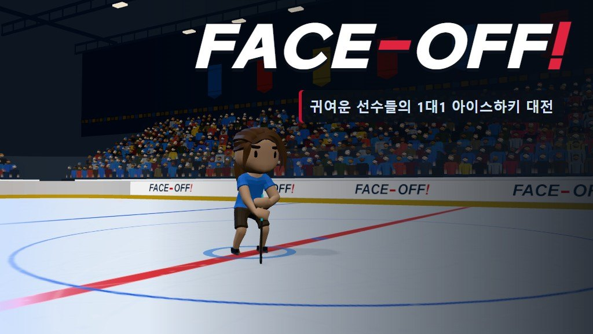
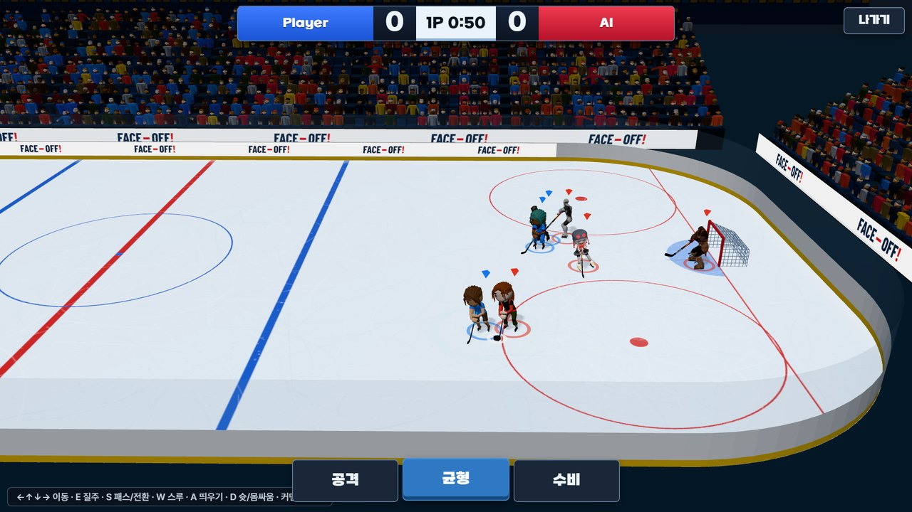
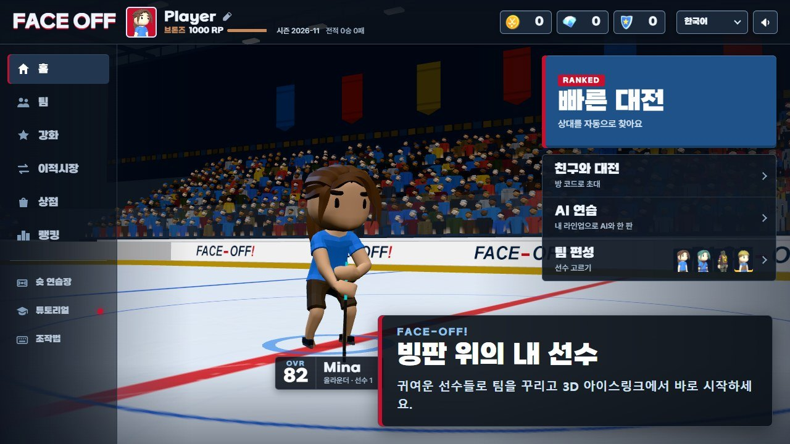
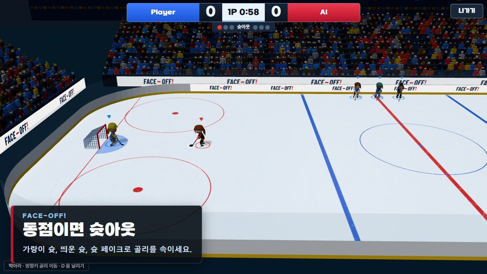
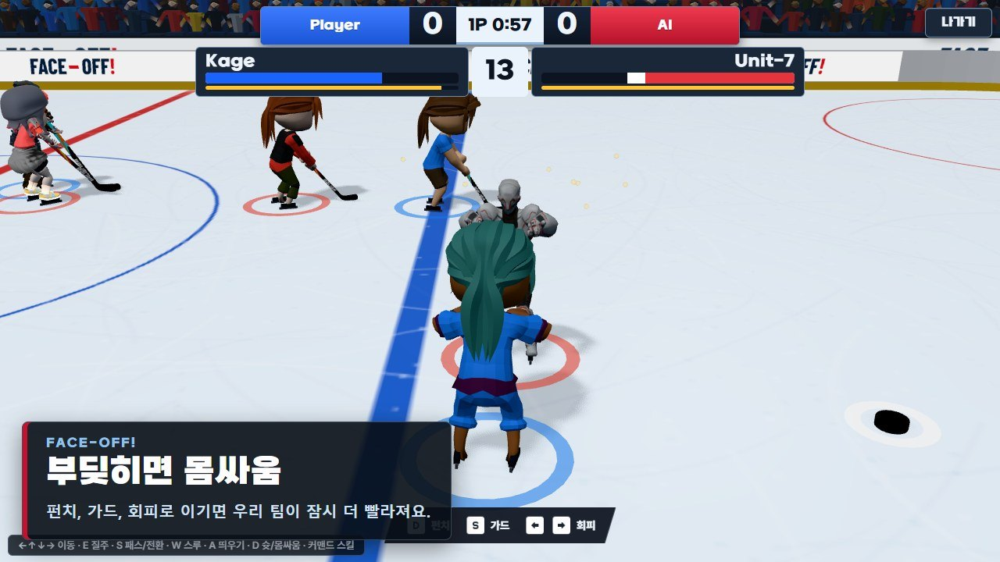
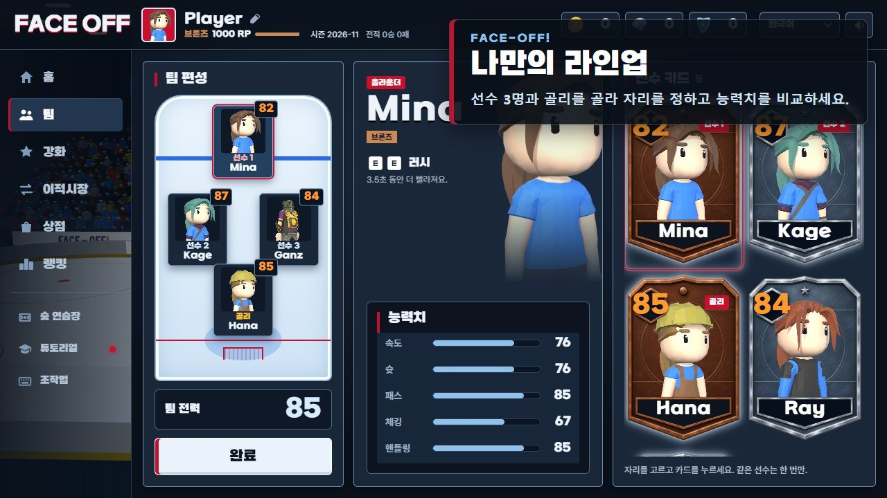
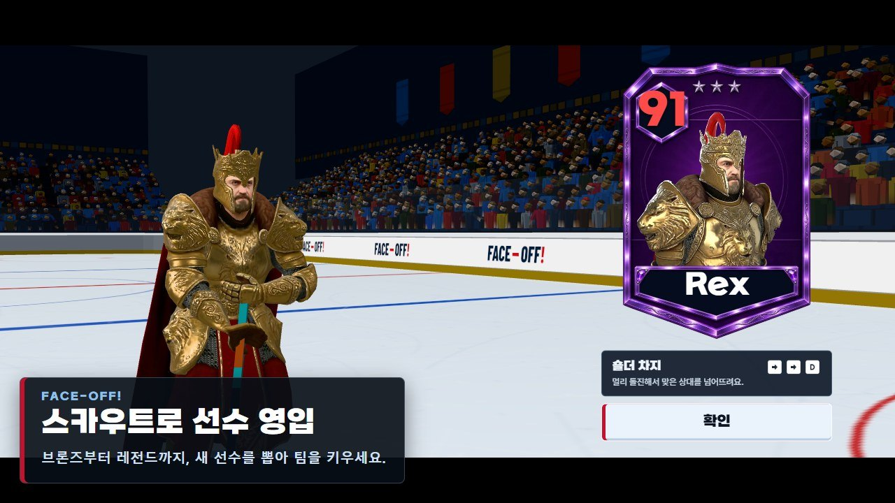
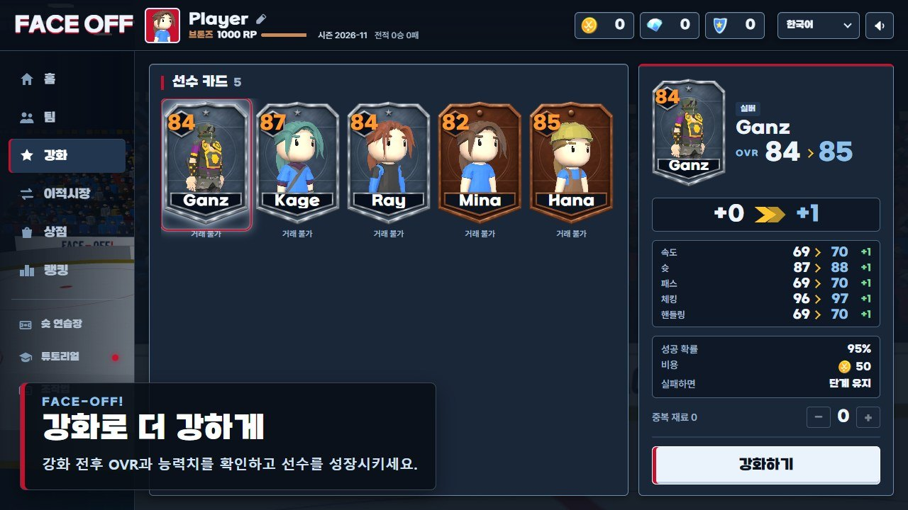
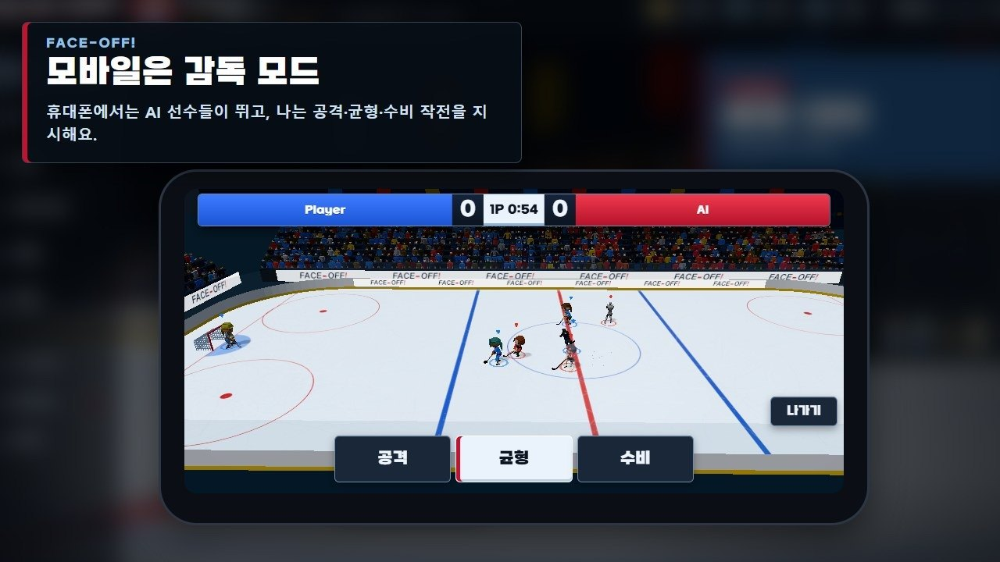

# FACE-OFF!

> 귀여운 선수들의 1대1 아이스하키 대전. 키보드로 직접 뛰거나, 폰에서는 작전 버튼으로 팀을 지휘합니다.

3인 스케이터 + 골리, 4명씩 맞붙는 3D 아이스하키 웹 게임입니다. 패스·슛·몸싸움·스킬 커맨드로 직접 플레이하는
PC 모드와, 내 라인업 AI에게 공격·균형·수비 작전을 지시하는 폰 감독 모드가 있습니다. 선수 카드를 스카우트하고
강화해서 라인업을 키우고, 스테이지·실시간 1:1 랭크전·친구 방에서 씁니다.

**▶ 플레이: https://verse8.io/W9K9g3w** (Verse8, PC·모바일 브라우저)

배포: Verse8 서비스 중 · 원스토어, YouTube Playables 출시 준비 중

<p>
  
</p>

<p>
  
  
</p>

## 어떤 게임인가

- **경기:** 4대4(스케이터 3 + 골리), 3피리어드. 이동·질주·패스·스루 패스·띄우는 패스·슛·몸싸움·선수 전환을
  키보드로 하고, 패스·슛은 길게 누를수록 세고 멀리 갑니다. 동점이면 연장, 그래도 같으면 슛아웃.
- **싸움:** 강한 몸싸움에 넘어지면 3초 안에 F로 싸움을 걸 수 있습니다. 펀치·가드·회피의 타이밍 대결이고,
  이긴 팀은 15초 동안 10% 빨라집니다.
- **스킬:** 역할(저격수·스피드형·플레이메이커·몸싸움형·벽형·올라운더)마다 스킬 하나. 축구 게임처럼
  방향키 + 버튼 커맨드로 씁니다.
- **폰 감독 모드:** 폰에서는 직접 조작 대신 내 라인업 AI가 경기를 뛰고, 공격(슛을 더 자주)·균형·수비(골문 앞
  지키기) 버튼으로 지휘합니다. 가로 화면 전용.
- **선수 카드:** 32명, 브론즈~레전드 5등급. 스카우트(1회·10회, 천장 보장), +10까지 강화(+3/+6/+9에
  동·은·금 배지), 이적시장 거래. 추천 포지션(FW/D/G)에서 벗어나 세우면 능력치가 깎입니다.
- **스테이지:** 2챕터 20개. "1분 안에 역전", "한 명 부족한 채로 버티기" 같은 시나리오와 보스전,
  스테이지마다 별 3개, 별 10·20·30개에 상자.
- **온라인:** 실시간 1:1 랭크전(시즌 RP·티어, 홈에 시즌 TOP 3), 방 코드로 친구 대전, 경기 중 채팅.
- **처음 들어온 사람:** 메뉴 없이 바로 튜토리얼(PC) 또는 코칭이 붙은 감독 스테이지(폰)로 시작합니다.

<p>
  
  
</p>

<p>
  
  
</p>

<p>
  
  
</p>

## 기술 스택

| 영역 | 사용 기술 |
|---|---|
| 클라이언트 | TypeScript(strict), Vite 8, DOM UI(홈·HUD·카드), 5개 언어(한·영·일·번체·간체) |
| 3D | three.js 0.186, Draco 압축 GLB, 스키닝 캐릭터 + 클립 블렌딩, 손가락·손목 IK |
| 시뮬레이션 | 고정 스텝(1/120 s) 결정론 경기 시뮬(`src/sim/match.ts`), 시드 난수 |
| 서버 | Verse8 Agent8 Game Server (`server/src/server.ts`: 매칭·방·랭킹·경제·스테이지 보상, `$lock`) |
| 플랫폼 | `@agent8/gameserver`, `@verse8/platform`(VX Shop), `@verse8/ads`(보상형 광고) |
| 테스트 | 시뮬 테스트 132개(`npm run sim:test`), Agent8 서버 하네스(`npm run server:test`) |
| 아트 | 캐릭터: Quaternius(CC0)·Sketchfab(CC BY 4.0)·Unity 에셋 → Blender Python으로 리타깃·GLB, UI 아트: Codex CLI 이미지 생성 |
| 사운드 | ElevenLabs 사운드 라이브러리, Kenney(CC0) 등 녹음된 클립 (코드 합성음 없음) |

## 구조에서 신경 쓴 것

**경기는 한 곳에서만 계산**
`Match`는 렌더링을 모르는 순수 시뮬레이션입니다. 같은 코드가 PC 직접 조작, 폰 감독 모드, 튜토리얼 드릴,
스테이지 시나리오, 헤드리스 테스트에서 그대로 돌아갑니다. 테스트는 이 시뮬을 수백 경기씩 돌려 "골대 뒤에서 퍽을
쥐고 버티는 선수를 AI가 8초 안에 뺏는가", "스루 패스가 패서에게 되돌아오지 않는가" 같은 행동을 숫자로 검사합니다.

**온라인 1:1은 호스트 권한 + 보간**
호스트가 시뮬을 돌려 30 Hz로 스냅샷을 보내고, 게스트는 입력만 보냅니다. 게스트는 자기 선수를 바로 예측해서
움직이고, 나머지는 70 ms 뒤에서 두 스냅샷 사이를 보간합니다. 잃은 패킷은 다음 값으로 덮어쓰는 "최신 값" 채널이고,
8초 동안 소식이 없으면 상대가 나간 것으로 처리합니다.

**결과·재화는 서버가 확정**
랭크 RP, 코인, 카드, 강화, 스카우트 천장, 스테이지 보상, 상자는 서버 함수가 계정 락 안에서 한 번만 지급합니다
(경기 ID·구매 ID 기록). 랭킹은 시즌마다 컬렉션을 나눠 복합 인덱스 없이 정렬합니다. 닉네임과 라인업은 계정에 저장해서
PC와 폰이 같은 팀을 씁니다. 오프라인 중에 바꾼 값은 표시해 두었다가 다음 연결 때 보냅니다.

**캐릭터 파이프라인**
서로 다른 팩(Quaternius, Sketchfab, Unity 에셋)의 리그를 Blender Python(`tools/blender/`)으로 같은 뼈 이름·크기로
맞추고, 스케이팅 클립을 월드 공간 회전 차이로 리타깃합니다. 주먹 쥔 손가락 포즈는 모델마다 Blender에서 만들어
`fists.json`으로 내보내고, 손가락 뼈가 없는 모델은 메시에서 손가락을 찾아 뼈를 심습니다(`finger_rig.py`).
카드 초상화도 같은 스크립트로 렌더해 머리가 가운데 오게 렌즈를 옮깁니다.

**UI는 코드로 그린 도형 대신 아트**
카드 프레임, 왕관·메달, 강화 배지, 별·자물쇠·상자 같은 아이콘은 Codex CLI 이미지 생성 → Python으로 배경 제거·크롭
(`tools/*_art.py`, 프롬프트는 `tools/codex_*_prompt.txt`)으로 만들었습니다. 다시 그린 에셋은 파일 이름을 바꿔
배포 캐시를 피합니다.

**PC·폰 가로 화면을 같은 페이지로**
폰은 가로 전용(세로로 들면 안내)이고, 작은 PC 창과 같은 배치를 씁니다. 화면 확인은 헤드리스 크롬(터치 에뮬레이션,
844x390·667x375)과 PC 1280x720·1920x1080·960x540에서 화면마다 직접 찍어서 했습니다.

## 실행

```bash
npm install
npm run dev            # http://localhost:5320
npm run build          # 타입 검사 + 배포 빌드
npm run sim:test       # 경기 시뮬·스테이지·AI 행동 테스트
npm run server:test    # Agent8 서버 하네스
```

개발용 주소:
- `?verse=nosuchverse-test` 서버 없이 로컬 로비로 실행
- `?account=<id>` 개발 계정 지정
- 콘솔 `__game.practice()`, `__game.stage('1-1')`, `__game.reveal([...])`

> 이 저장소에는 Unity 에셋 스토어 라이선스 모델(Cyber Soldier, Mking, Jelly Fish Girl, GanzSe, IdaFaber
> Swordsman Girl, Bodyguard 팩)의 GLB가 들어 있지 않습니다. 스토어 라이선스가 원본 파일 공개 배포를 허용하지 않기
> 때문입니다. 이 캐릭터들은 위 플레이 링크에서 볼 수 있고, 로컬 실행 시에는 해당 선수의 모델을 불러오지 못합니다.

## 조작 (PC)

| 키 | 동작 |
|---|---|
| 방향키 | 이동 |
| E | 질주 |
| S | 패스 / 선수 전환 (퍽이 없을 때) |
| W | 스루 패스 |
| A | 띄우는 패스 |
| D | 슛 / 몸싸움 (퍽이 없을 때) |
| 방향키 + D 등 | 스킬 커맨드 |
| F | 싸움 신청 (넘어졌을 때) |

## 폴더

```
src/
  sim/          경기 시뮬레이션(규칙·AI·물리), 상수, 이벤트 타입
  game/         세션(로컬·호스트·게스트), 튜토리얼, 스테이지(정의·실행·화면·동기화),
                선수 명단·등급·스킬, 경제(강화·이적시장·상점), 스카우트 공개, 조작법 가이드
  render/       three.js 장면(링크·관중·카메라), 캐릭터(애니메이션·IK·스틱), 충돌 연출
  net/          Agent8 로비·매칭·방, 호스트/게스트 프로토콜
  hud.ts        경기 HUD
  main.ts       화면 전환, 홈·팀·랭킹, 계정 동기화
server/src/     게임 서버 (매칭·랭킹·경제·스테이지·닉네임)
tests/          시뮬·AI·스테이지·필터 테스트
tools/          Blender 자동화(리타깃·주먹 포즈·손가락 리그·초상화), Codex 아트 변환, 가이드 영상 녹화
docs/           설계 문서, 스크린샷
public/         GLB 모델·애니메이션, 초상화, UI 아트, 사운드, 가이드 영상
```

## 크레딧

- 캐릭터: Quaternius (CC0), Sketchfab CC BY 4.0 작가들(게임 안 크레딧 화면에 작품·작가·라이선스 표기), Unity 에셋 스토어 팩
- 사운드: ElevenLabs 사운드 라이브러리, Gregor Quendel (관중), Kenney (UI, CC0)
